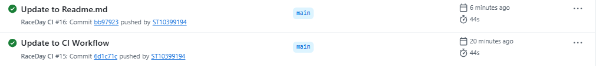

# RaceDay Event Management System

## Project Overview

RaceDay is a full-stack, web-based event management system developed specifically for the South African road running, walking and cycling community.

South Africa hosts numerous sporting events, including the Comrades Marathon, Two Oceans Marathon, Cape Town Cycle Tour, Soweto Marathon and various local community races. However, many event organisers still rely on manual registration processes, spreadsheets and disconnected communication channels to manage their events.

RaceDay aims to simplify these processes by providing a centralised, API-driven platform where event organisers can manage sporting events and participants can discover events, enrol in races and track their performance.

The system is developed using ASP.NET Core, .NET 8, Entity Framework Core, Microsoft SQL Server and an MVC front end. It is structured as a multi-project solution and incorporates authentication, role-based authorisation, automated testing, cloud storage and containerisation.

## User Roles and Responsibilities

### Organiser

Organisers are responsible for creating and managing sporting events.

Their main responsibilities include:

- Creating, updating and deleting sporting events.
- Creating and managing event categories.
- Viewing participants enrolled in their events.
- Managing participant enrolment statuses.
- Uploading event banner images.
- Recording participant finishing times and positions.
- Viewing results for events they organise.

### Participant

Participants use RaceDay to discover sporting events and manage their participation.

Their main responsibilities include:

- Registering and logging into the platform.
- Browsing available sporting events.
- Viewing event information and categories.
- Enrolling in sporting events.
- Viewing their enrolment history.
- Updating their personal profiles.
- Viewing their race results and finishing positions.

## Technologies Used

| Technology | Purpose |
|---|---|
| C# | Main programming language |
| ASP.NET Core Web API | Backend application and REST API |
| ASP.NET Core MVC | User interface |
| .NET 8 | Application framework |
| Entity Framework Core | Database access and Code-First development |
| Microsoft SQL Server | Relational database |
| Swagger / OpenAPI | API documentation and testing |
| xUnit | Automated integration testing |
| Azure Blob Storage | Event banner image storage |
| Docker | Application containerisation |
| GitHub Actions | Continuous integration and automated testing |
| Visual Studio 2022 | Development environment |

## Project Structure

The solution is organised into separate projects to maintain a clear separation of responsibilities.

```text
RaceDay/
│
├── .github/
│   └── workflows/
│       └── main.yml
│
├── docs/
│   ├── ERD.png
│   ├── API_Endpoint_Plan.pdf
│   ├── RaceDay_Schema.sql
│   └── github-actions-success.png
│
├── RaceDay.Api/
│   ├── Controllers/
│   ├── Data/
│   ├── Models/
│   ├── Migrations/
│   ├── Services/
│   ├── Program.cs
│   └── appsettings.json
│
├── RaceDay.Contracts/
│   └── Dtos.cs
│
├── RaceDay.Api.Tests/
│   ├── RaceDayWebApplicationFactory.cs
│   ├── AuthenticationTests.cs
│   ├── EventAndCategoryTests.cs
│   ├── EnrollmentTests.cs
│   ├── ResultTests.cs
│   ├── RoleAuthorizationTests.cs
│   ├── TestAuthHelper.cs
│   ├── TestData.cs
│   └── ApiRoutes.cs
│
├── RaceDay.Mvc/
│   ├── Controllers/
│   ├── Models/
│   ├── Services/
│   ├── Views/
│   ├── wwwroot/
│   ├── Program.cs
│   ├── Dockerfile
│   └── appsettings.json
│
├── RaceDay.sln
└── README.md
```

## Prerequisites

Before running RaceDay, ensure that the following software and tools are installed:

- Visual Studio 2022 with the ASP.NET and web development workload.
- .NET 8 SDK.
- Microsoft SQL Server or SQL Server LocalDB.
- SQL Server Management Studio (SSMS).
- Git.
- Docker Desktop.
- An Azure Storage Account for event banner image storage.
- A GitHub account for accessing the repository and CI/CD workflow.

## Database Setup

RaceDay uses Microsoft SQL Server with Entity Framework Core Code-First migrations to create and manage the database.

### Configure the Database Connection

1. Open `RaceDay.sln` in Visual Studio 2022.
2. Open `RaceDay.Api/appsettings.json`.
3. Locate the `ConnectionStrings` section.
4. Update the `DefaultConnection` value to match your local SQL Server configuration.

Example LocalDB connection:

```json
{
  "ConnectionStrings": {
    "DefaultConnection": "Server=(localdb)\\MSSQLLocalDB;Database=RaceDayDb;Trusted_Connection=True;MultipleActiveResultSets=true"
  }
}
```

### Apply Database Migrations

1. Open **Tools → NuGet Package Manager → Package Manager Console**.
2. Set the Default Project to `RaceDay.Api`.
3. Execute:

```powershell
Update-Database
```

4. Wait for Entity Framework Core to complete the migration.
5. Open SQL Server Management Studio.
6. Connect to your SQL Server instance and confirm that the RaceDay database and its tables have been created.

The database stores information relating to users, events, event categories, enrolments and race results.

## How to Run RaceDay.Api

The RaceDay API handles the backend operations, database communication, authentication, authorisation and business logic.

1. Open the solution in Visual Studio 2022.
2. Configure the database connection string.
3. Set `RaceDay.Api` as the startup project.
4. Build the solution.
5. Press **F5** or click the Start button.
6. Once the API starts, open Swagger using the displayed application address.

Example:

```text
https://localhost:<port>/swagger
```

Replace `<port>` with the HTTPS port assigned to your API.

Swagger provides an interactive interface for testing the available API endpoints and viewing their responses.

## How to Run RaceDay.Mvc Locally

The RaceDay MVC application provides the graphical user interface through which Organisers and Participants interact with the system.

The MVC application communicates with the backend API using the `RaceDayApiClient` service.

### Configuration

1. Make sure the RaceDay API is running.
2. Open `RaceDay.Mvc/appsettings.json`.
3. Configure the API base URL.

Example:

```json
{
  "ApiSettings": {
    "BaseUrl": "https://localhost:<API-PORT>/"
  }
}
```

Replace `<API-PORT>` with the actual API port.

### Starting the MVC Application

1. Set `RaceDay.Mvc` as the startup project in Visual Studio.
2. Ensure that the API is accessible.
3. Press **F5** to run the application.
4. The MVC website will open in your default browser.

Users can then register, log in and access the functionality available to their assigned roles.

## Azure Blob Storage Setup

RaceDay uses Azure Blob Storage to store event banner images.

Azure Blob Storage allows images to be stored separately from the SQL Server database. The database stores the image URL associated with each event.

### Configuration Steps

1. Sign in to the Microsoft Azure Portal.
2. Create or select an Azure Storage Account.
3. Navigate to the storage account's **Containers** section.
4. Create a container for event banner images.
5. Obtain the storage account connection string.
6. Configure the connection string and container name in the API application.

Example configuration:

```json
{
  "AzureStorage": {
    "ConnectionString": "<YOUR-AZURE-STORAGE-CONNECTION-STRING>",
    "ContainerName": "<YOUR-CONTAINER-NAME>"
  }
}
```

7. Ensure that the `BlobStorageService` is registered in the API dependency injection container.
8. Test the event banner upload functionality.

**Security:** Actual Azure connection strings and access keys must not be committed to GitHub. Use environment variables or GitHub Secrets to protect sensitive configuration information.

## Docker Setup

Docker is used to package the RaceDay MVC application into a container, allowing it to run in a consistent environment.

Ensure that Docker Desktop is installed and running before proceeding.

### Build Image

Open a terminal in the solution's root directory and execute:

```bash
docker build -t raceday-mvc:part3 -f RaceDay.Mvc/Dockerfile .
```

This builds a Docker image named `raceday-mvc:part3`.

### Run Container

Start the container using:

```bash
docker run -d --name raceday-mvc -p 8080:8080 -e ApiSettings__BaseUrl=http://host.docker.internal:5000/ raceday-mvc:part3
```

The API URL must match the address and port accessible from inside the container.

To check whether the container is running:

```bash
docker ps
```

To view application logs:

```bash
docker logs raceday-mvc
```

To stop the container:

```bash
docker stop raceday-mvc
```

To remove the container:

```bash
docker rm raceday-mvc
```

Once the container is running, access the MVC application through:

```text
http://localhost:8080
```

**Note:** The API must also be running and reachable from the MVC container. The example above assumes that the API is accessible on port `5000`. Update the URL if your API uses a different port.

## Authentication and Session Flow

RaceDay implements authentication and role-based authorisation to protect user accounts and application functionality.

The system supports two roles: Organiser and Participant.

The authentication process follows these steps:

1. A user registers an account through the registration endpoint.
2. The API validates the submitted information.
3. The user's password is securely hashed before being stored in the database.
4. The user submits their login credentials.
5. The API verifies the credentials and establishes the authenticated session or token.
6. The user's assigned role determines which endpoints and features they can access.
7. When the user logs out, the authentication state is cleared.

The MVC application communicates with the API and maintains the appropriate authentication state between requests.

Protected API endpoints use role-based authorisation to prevent users from accessing functionality outside their assigned permissions.

**Authentication implementation note:** The MVC application and API must use a consistent authentication mechanism. When JWT Bearer authentication is configured, the MVC client must forward the JWT through the `Authorization` header. When cookie authentication is used, the appropriate authentication cookie must be forwarded.

## Organiser Features

Organisers have access to administrative functionality for managing their sporting events.

The available features include:

- Organiser registration and login.
- Creating sporting events.
- Updating event information.
- Deleting events.
- Creating and managing event categories.
- Viewing participants enrolled in their events.
- Managing enrolment statuses.
- Uploading event banner images.
- Recording participant finishing times.
- Assigning finishing positions.
- Viewing results for their own events.

Organiser functionality is protected through role-based authorisation. Organisers can only manage resources they are authorised to access.

## Participant Features

Participants can use RaceDay to discover sporting events and manage their participation.

The available features include:

- Participant registration and login.
- Browsing available sporting events.
- Viewing individual event details.
- Viewing event categories.
- Enrolling in sporting events.
- Viewing personal enrolment history.
- Updating personal profile information.
- Viewing personal race results.
- Tracking finishing times and positions.

Participants are restricted from accessing administrative functionality reserved for Organisers.

## CI/CD

RaceDay uses GitHub Actions to automate the build and testing process.

The workflow configuration is stored in:

```text
.github/workflows/main.yml
```

The workflow is triggered when code is pushed to the configured branches or when a pull request is created.

### Automated Workflow

The GitHub Actions pipeline performs the following operations:

1. Checks out the latest repository code.
2. Installs the .NET 8 SDK.
3. Restores the solution's NuGet dependencies.
4. Builds the solution using the Release configuration.
5. Runs the xUnit integration tests.
6. Reports whether the build and tests have completed successfully.

### Automated Testing

The `RaceDay.Api.Tests` project uses xUnit and `WebApplicationFactory` to perform integration testing against the API.

The tests use an in-memory database to isolate test data and avoid depending on a local SQL Server instance.

The automated tests cover:

- User registration and login.
- Password hashing and validation.
- Session management.
- Profile management.
- Event creation and management.
- Category management.
- Participant enrolments.
- Result capturing.
- Role-based access restrictions.
- Unauthorised and forbidden requests.

This process helps identify application errors and security issues before code changes are merged into the main branch.

## GitHub Actions Screenshot

The following screenshot provides evidence of the RaceDay GitHub Actions workflow execution.

   

The screenshot should show the successful workflow run, including the solution build and automated test execution.

## Video Presentation

The RaceDay video presentation demonstrates the application and provides an overview of its functionality and implementation.

The presentation covers the system's main features and demonstrates how Organisers and Participants interact with the platform.

**Watch the RaceDay project presentation:**

[RaceDay Event Management System – Video Presentation](https://youtu.be/TkaczqjlGLU)

## Project Deliverables

The project documentation and design deliverables are located in the `docs` directory.

| Deliverable | File |
|---|---|
| Entity Relationship Diagram | `docs/ERD.png` |
| API Endpoint Plan | `docs/API_Endpoint_Plan.pdf` |
| SQL Schema Script | `docs/RaceDay_Schema.sql` |
| GitHub Actions Evidence | `docs/github-actions-success.png` |

## Conclusion

RaceDay provides a centralised event management solution for South African road running, walking and cycling events.

By combining an ASP.NET Core Web API, an MVC front end, SQL Server, Azure Blob Storage, automated integration testing and Docker containerisation, the project demonstrates the development of a structured, secure and maintainable full-stack application.

The system aims to improve event administration, simplify participant enrolments and provide a more organised way to manage sporting events and race results.